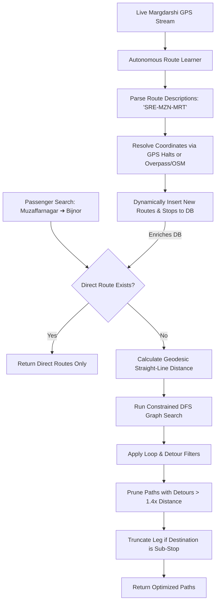

# UP Bus Live - Route Finder Optimization & Scaling Plan

This document presents our updated research, findings, and architectural plan to resolve redundant transit recommendations (e.g., detours through Moradabad) and scale the route network to cover the entire state of Uttar Pradesh (UP).

---

## 🔍 Root Cause Analysis of Redundant Routes

In the search from **Muzaffarnagar Depot** to **Bijnor Bus Stand**, the system suggested a route passing through **Moradabad Depot** (Option 5: Muzaffarnagar $\rightarrow$ Saharanpur $\rightarrow$ Moradabad $\rightarrow$ Bijnor). 

This occurred due to two distinct issues:

1. **Algorithmic Graph Search Unconstrained by Detours**:
   - The pathfinder (`findPathsDFS` in `graph.ts`) uses a Depth-First Search (DFS) with a maximum transfer limit of 2.
   - Currently, it explores *all* possible edges without checking if the route is taking a massive detour or looping back.
   - Since `Saharanpur - Bijnor - Moradabad` is a single route, the pathfinder was able to travel past Bijnor to Moradabad, and then transfer to a returning bus to Bijnor.
2. **Missing Direct Route Data**:
   - Muzaffarnagar and Bijnor are close (~60 km), and direct buses run between them. However, our database lacks a direct route record. 
   - Because of this data gap, the pathfinder was forced to find multi-hop connections.

---

## 🛠️ Third-Party API Evaluation

We researched the APIs and platforms provided for transit routing in India:

| API Provider | Type | Public Transit Support in UP | Driving/Road Geometry Support | Suitability & Recommendation |
| :--- | :--- | :--- | :--- | :--- |
| **Google Routes API** | Multimodal Router | ❌ Low (Requires UPSRTC GTFS partnership) |  High (Real-time traffic, polylines, ETAs) | **Excellent for Road Matching**: We can use it to fetch driving geometry and geocode waypoints. |
| **MapmyIndia (Mappls)** | Regional India Maps | ❌ Low (Metro bus only; lacks rural UP) |  High (Highest local town/village accuracy) | **Best for Local Geocoding**: Outstanding coverage of small UP towns, depots, and junctions. |
| **Geoapify API** | OpenStreetMap Router | ❌ Low (No static UPSRTC schedules) |  Medium (OpenSource OSM routing) | **Cost-Effective Alternative**: Good for driving paths, but lacks official UP roadways schedules. |
| **Nominatim / Overpass** | Open Map Data | ❌ Low (Bus stops are sparse) |  High (Free, open-source geocoding) | **Zero-Cost Geocoding**: No API keys required. We will use it alongside Overpass (already integrated) as a geocoder fallback. |
| **UPSRTC Margdarshi** | Official State GPS |  High (Direct live stream of all running buses) | ❌ None | **Gold Standard for Live Data**: We already use it for GPS, but it also contains route descriptions! |

---

## 🚀 Proposed 3-Tier Scalable Architecture

We propose a scalable, self-learning solution to fix route redundancies and expand coverage across all 75 districts of Uttar Pradesh.

### Tier 1: Algorithmic Routing Engine Upgrades (Instant Fix)
We will add strict pruning constraints to the DFS search in [graph.ts](file:///c:/Users/Azad%20Singh/Desktop/upbus/apps/backend/src/engine/graph.ts):
1. **Loop & Intermediate Destination Pruning**:
   - If our destination stop (e.g., Bijnor) lies in the middle of a bus route (e.g., Saharanpur $\rightarrow$ Najibabad $\rightarrow$ Bijnor $\rightarrow$ Moradabad), the pathfinder must **truncate the leg at that stop**. It will not allow the path to proceed further to Moradabad and transfer back.
2. **Detour Distance Filter**:
   - Compute the straight-line (geodesic) distance between the source and destination.
   - If any transfer path has a total distance $> 1.4 \times$ the straight-line distance, **prune it immediately**. This will auto-reject the 237 km detour through Moradabad for a 60 km journey.
3. **Strict Transfer Ordering**:
   - If a route with $N$ transfers is found, automatically ignore any route with $> N$ transfers unless it is faster.

### Tier 2: Autonomous Route Learning Engine (Scalable UP-Wide Data)
Instead of manually entering routes or relying on non-existent GTFS feeds, we can make the backend **self-learning**:
1. **Margdarshi Ingest Analyzer**:
   - The Margdarshi API (`getGpsLiveData.php`) provides live GPS packets for every running bus in UP. Each packet contains a `route_description` field (e.g. `"SAHARANPUR-DEOBAND-MUZAFFARNAGAR"` or `"MUZAFFARNAGAR-BIJNOR"`).
2. **Dynamic DB Ingestion**:
   - We will write a background job that parses these route description strings.
   - If a route description contains stops not in our database, it will query the **Nominatim (OpenStreetMap) Geocoding API** or our local **Overpass API client** (which is already integrated in `utils/overpass.ts`) to resolve coordinates.
   - It will automatically insert the new stops, routes, and sequences into the database.
   - **Result**: As UP roadways buses run, the system automatically builds and updates the transit map for the entire state!

---

## ⏱️ Incremental Network Discovery & Seeder Plan

Since UPSRTC operates approximately 12,000+ buses daily, almost every active route in the state will have at least one bus running on it within a single day. Rather than waiting for passive discovery, we will implement an **Incremental Accumulative Seeder** script to build a complete state-wide database.

### 1. Ingestion Strategy (2-Second Polling & Laptop Resiliency)
- **Polling Interval**: The script will poll `https://margdarshi.upsrtcvlt.com/php/getGpsLiveData.php` every **2 seconds** during active sessions to capture fine-grained real-time coordinate streams.
- **Laptop Shutdown Resiliency (Incremental Discovery)**:
  - If you close your laptop or stop the server, the script is **100% resilient**. 
  - Every discovered stop, route, and sequence is immediately committed to the local database and cached in `discovered_routes.json`.
  - When you turn on your laptop and run `npm run dev` again, the seeder automatically resumes, checking already saved routes and only adding *newly discovered* ones.
  - Over a few hours of developer testing, the database will naturally and rapidly seed itself with the active roadways network.

### 2. Geocoding Without API Keys
We will use three methods to get stop coordinates without requiring commercial API keys:
1. **GPS Halt Approximation (Primary)**:
   - When a bus reporting location on route `A-B-C` slows down and stops (speed = 0) near a known town, we capture its actual GPS coordinates and assign it as the location of the depot/bus stand. This utilizes the crowd-sourced GPS data itself.
2. **Overpass API (Secondary)**:
   - We will query our pre-integrated OpenStreetMap **Overpass API** (`utils/overpass.ts`) to search for nodes in Uttar Pradesh labeled as `amenity=bus_station`, `highway=bus_stop`, or city boundaries.
3. **Nominatim (OpenStreetMap Geocoding)**:
   - Free, keyless geocoding service to search for the coordinates of small-town names parsed from `route_description`.
