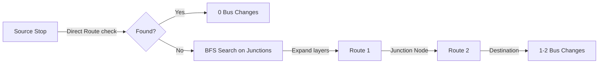

# UPBus: 3-Layer Graph Architecture & Journey Planning Design

This document answers the structural and algorithmic questions regarding the implementation of a 3-layer graph model for Uttar Pradesh roadways.

```mermaid
graph TD
    subgraph Layer 1: Road Graph (Physical Infrastructure)
        N1[Node: Stop/Junction] -->|Road/Distance| N2[Node: Stop/Junction]
    end
    subgraph Layer 2: Bus Graph (Schedules & Operations)
        B1[Bus Route: UP11-001] -.->|Sequence of Stops| N1
        B1 -.->|Timings / Frequency| N2
    end
    subgraph Layer 3: Route Generator (Search & Routing)
        RG[DFS/BFS Engine] -->|Finds| Direct[0 Changes]
        RG -->|Finds| Indirect[1-2 Changes]
        RG -->|Filters| Circular[Circular/Alternative Routes]
    end
```

---

## 1. PostgreSQL + PostGIS Database Schema Design

By separating the physical road network (Layer-1) from bus schedules (Layer-2), we eliminate data duplication. If multiple routes share the same road segment, the coordinates are stored only once.

### Layer-1: Road Graph (Physical Layers)
```sql
-- Enable PostGIS extension for spatial queries
CREATE EXTENSION IF NOT EXISTS postgis;

-- Nodes: Bus stations, stops, and highway intersections
CREATE TABLE nodes (
    id SERIAL PRIMARY KEY,
    node_code VARCHAR(50) UNIQUE NOT NULL, -- e.g., 'N_AGRA_FORT'
    name VARCHAR(255) NOT NULL,            -- e.g., 'Agra Fort Bus Station'
    district VARCHAR(100) NOT NULL,
    is_junction BOOLEAN DEFAULT false,     -- Flag if multiple routes cross here
    geom GEOMETRY(Point, 4326) NOT NULL    -- Spatial location (Lat/Lon)
);

-- Spatial index on coordinates for rapid proximity/nearest stop searches
CREATE INDEX idx_nodes_geom ON nodes USING GIST(geom);

-- Roads: Direct physical connections (edges) between nodes
CREATE TABLE roads (
    id SERIAL PRIMARY KEY,
    from_node_id INT REFERENCES nodes(id) ON DELETE CASCADE,
    to_node_id INT REFERENCES nodes(id) ON DELETE CASCADE,
    distance_km NUMERIC(6, 2) NOT NULL,
    geom GEOMETRY(LineString, 4326),        -- Optional: actual road path shape
    UNIQUE (from_node_id, to_node_id)
);

CREATE INDEX idx_roads_nodes ON roads(from_node_id, to_node_id);
```

### Layer-2: Bus Graph (Operational Layers)
```sql
-- Bus Routes: Abstract routes
CREATE TABLE bus_routes (
    id SERIAL PRIMARY KEY,
    route_code VARCHAR(50) UNIQUE NOT NULL, -- e.g., 'R_LKO_AGR_EXP'
    name VARCHAR(255) NOT NULL              -- e.g., 'Lucknow-Agra Express Route'
);

-- Stop Sequence: Links routes (Layer-2) to physical nodes (Layer-1)
CREATE TABLE bus_route_stops (
    route_id INT REFERENCES bus_routes(id) ON DELETE CASCADE,
    node_id INT REFERENCES nodes(id) ON DELETE CASCADE,
    sequence_no INT NOT NULL,
    distance_from_start_km NUMERIC(6, 2) NOT NULL,
    PRIMARY KEY (route_id, sequence_no)
);

-- Index for sequence lookup during route reconstruction
CREATE INDEX idx_route_stops_lookup ON bus_route_stops(route_id, node_id, sequence_no);

-- Timings and Frequency per Bus Trip
CREATE TABLE bus_trips (
    id SERIAL PRIMARY KEY,
    route_id INT REFERENCES bus_routes(id) ON DELETE CASCADE,
    bus_reg_no VARCHAR(20) NOT NULL,        -- Bus Registration number
    departure_time TIME NOT NULL,           -- Starting time
    frequency_minutes INT DEFAULT NULL      -- If running periodically (e.g. every 30 mins)
);
```

---

## 2. Junctions: Detection & Transfer Representation

### What is a Junction?
A **Junction** is a physical node (stop) in Layer-1 where two or more distinct bus routes intersect. It is the only place where a passenger can swap buses.

### Automatic Junction Detection
We run a trigger or background scheduler to automatically flag junctions:
```sql
UPDATE nodes
SET is_junction = true
WHERE id IN (
    SELECT node_id
    FROM bus_route_stops
    GROUP BY node_id
    HAVING COUNT(DISTINCT route_id) >= 2
);
```

### Role in Routing
Instead of searching across all 10,000+ stops, the routing algorithm only considers **Junction nodes** for bus changes. This dramatically reduces the graph search space.

---

## 3. Route Generation Algorithms (DFS, BFS, Backtracking)



### A. Direct Route Detection (0 Changes)
To check if a direct route exists between Stop A and Stop B:
- Check if both stops share the same `route_id` where $Sequence(A) < Sequence(B)$.
- **Complexity**: $O(1)$ index lookup.

### B. Indirect Route Generation (DFS vs BFS)
We model our search on the **Bus Route network** (where vertices = bus routes, edges = shared junctions).

* **BFS (Breadth-First Search)**:
  - **Use Case**: Finding the path with the **least number of transfers** (e.g., 1 transfer, then 2 transfers).
  - **How it works**: Starts at the source routes, expands to all adjacent routes via shared junctions, and stops as soon as the target route is reached.

* **DFS (Depth-First Search) + Backtracking**:
  - **Use Case**: **Route Enumeration** (finding alternative routes, circular loops, or merged routes).
  - **How it works**: Explores as deep as possible along a route sequence, backtracks when it hits a dead-end or exceeds the maximum transfer limit (usually capped at 2 transfers for passenger comfort).

---

## 4. Journey Planning Algorithms

Passengers prioritize routes using multiple metrics: **Least Transfers > Shortest Distance > Minimum Time**.

### A. RAPTOR (Round-Based Public Transit Routing)
For scalable transit networks, standard Dijkstra is slow because it doesn't handle timetable schedules and transfers efficiently. **RAPTOR** is the state-of-the-art alternative:
- **Round 0**: Find all stops reachable from the source with 0 transfers.
- **Round 1**: Find all stops reachable from the stops in Round 0 with 1 transfer (by boarding buses at shared junctions).
- **Round 2**: Find all stops reachable with 2 transfers.
- **Result**: Guarantees finding Pareto-optimal journeys (least transfers and fastest arrival times) in milliseconds.

### B. Multi-Criteria Sorting
After generating candidate journeys:
1. **Filter by transfers**: Prioritize 0-change, then 1-change, then 2-change.
2. **Sort by Time/Distance**: Apply a weight formula:
   $$\text{Weight} = \text{Travel Time} + (\text{Transfer Penalty} \times 20\text{ mins})$$

---

## 5. Scalability for Uttar Pradesh (10k+ Stops, 100k+ Routes)

To handle lakhs of daily searches across a massive state-wide network:

1. **Graph Pruning (Bounding Box & Spatial Corridors)**:
   - Before running DFS/BFS, filter out routes that go in the opposite direction.
   - Draw a bounding box around the source and destination (expanded by 50km) and only search nodes within this box. This eliminates 90% of the graph.
2. **Precomputed Transfers**:
   - Precompute and store the connection matrix for all major junctions (e.g., Charbagh, Anand Vihar, Saharanpur Depot).
3. **Redis Caching**:
   - Cache results for common search pairs (e.g., `Saharanpur -> Delhi`, `Lucknow -> Kanpur`).
4. **Database Indexing**:
   - Use composite indices on `bus_route_stops(route_id, sequence_no)` and spatial GIST indices on coordinates.
